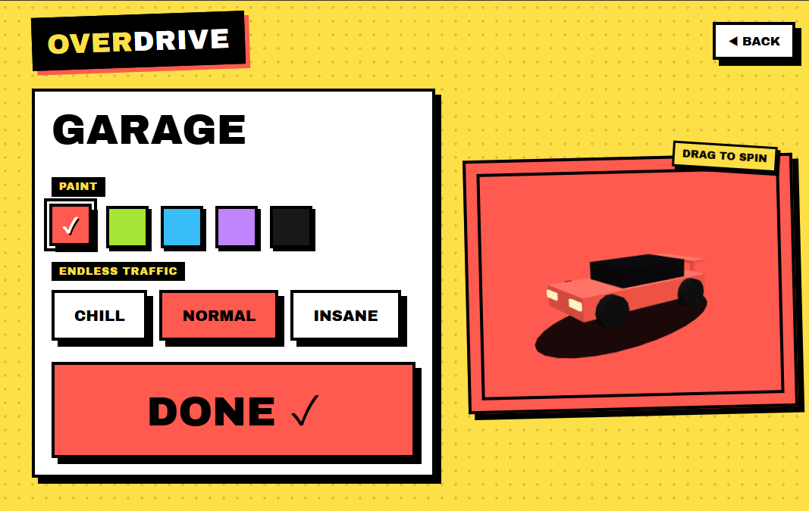
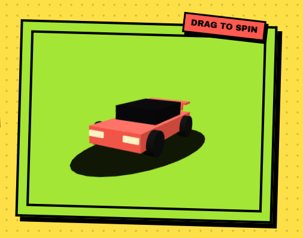

<div align="center">

# OVERDRIVE

### NO BRAKES. NO LIMITS. JUST DRIVE.

A browser-based 3D driving game featuring endless highway traffic, competitive track racing, and a customizable garage.



[Gameplay](#-game-modes) · [Features](#-features) · [Controls](#-controls) · [Getting Started](#-getting-started)

</div>

---

## 🏁 About

**OVERDRIVE** is a 3D driving game that puts you behind the wheel in two different ways: survive an endless highway packed with traffic, or compete in circuit races against AI drivers or a friend sharing your keyboard.

Choose your car colour, tune the challenge to your liking, and see how far—or how fast—you can go.

## 🎮 Game Modes

### 1. Endless Traffic

Drive along a three-lane highway and avoid incoming traffic for as long as possible.

- Automatic acceleration—the longer you survive, the faster you go.
- Dodge traffic and obstacles.
- Choose between **Chill**, **Normal**, and **Insane** traffic difficulty.
- Your distance is your score.
- Your best distance is saved locally on your device.

### 2. AI Race

Race against computer-controlled opponents on a circuit.

- Choose from **1 to 5 AI opponents**.
- Select **Easy**, **Normal**, or **Hard** AI difficulty.
- Pick a track and set the number of laps.
- Compete for the best finishing position.

### 3. Buddy Race

Two players. One keyboard. One screen.

- Local split-screen multiplayer.
- Each player has independent driving controls and a camera.
- Race against each other on the selected circuit.
- No online multiplayer.

## ✨ Features

- **3D graphics:** Cars, roads, traffic, scenery, and circuits rendered with Three.js.
- **Car garage:** Choose from five paint colours.
- **Interactive car preview:** Drag to rotate your car in the menus.
- **Endless highway:** Three-lane traffic-dodging gameplay.
- **Circuit racing:** Two selectable tracks with different layouts and difficulty ratings.
- **AI drivers:** Multiple opponent driving styles.
- **Drifting:** Handbrake-assisted drifting in track races.
- **Race HUD:** Lap position, timer, speed, drift distance, and minimap.
- **Camera options:** Switch between three camera views during track races.
- **Sound:** Procedurally generated engine and gameplay effects, with a mute option.
- **Local persistence:** Garage settings and best endless-run distance are stored in browser local storage.
- **Responsive menus:** Menu layouts adapt to smaller screens.

## 🖼️ Screenshots

### Garage & Customization

Choose your paint colour and traffic difficulty, then inspect your car in the interactive 3D preview.


### 3D Car Preview

The car preview can be rotated by dragging with your mouse or pointer.



## 🎯 Controls

### Endless Traffic

| Action | Keyboard |
|---|---|
| Steer left | `A` or `←` |
| Steer right | `D` or `→` |
| Boost / accelerate | `W` or `↑` |
| Brake | `S`, `↓`, or `Space` |
| Pause / resume | `Esc` or `P` |
| Mute / unmute | `M` |

**Touch controls:** Hold the left or right half of the screen to steer.

### AI Race

| Action | Keyboard |
|---|---|
| Accelerate | `W` or `↑` |
| Brake | `S` or `↓` |
| Steer | `A` / `D` or `←` / `→` |
| Handbrake / drift | `Space` or `Shift` |
| Change camera | `C` |
| Respawn | `R` |
| Pause / quit | `Esc` |

### Buddy Race

| Action | Player 1 | Player 2 |
|---|---|---|
| Accelerate | `W` | `↑` |
| Brake | `S` | `↓` |
| Steer left | `A` | `←` |
| Steer right | `D` | `→` |
| Handbrake / drift | `Left Shift` | `Right Shift` |
| Change camera | `C` | `/` |
| Respawn | `R` | `Enter` |

> **Note:** Track racing requires a keyboard. Touch controls are available for Endless Traffic.

## 🏎️ Tracks

| Track | Difficulty |
|---|---|
| Sunset Circuit | Medium |
| Neon Hairpins | Hard |

Track races support **1, 2, 3, or 5 laps**.

## 🚀 Getting Started

OVERDRIVE is a client-side browser game. There is no build process or package installation required.

1. Clone this repository:

   ```bash
   git clone https://github.com/YOUR-USERNAME/OVERDRIVE.git
   ```

2. Open the project folder.

3. Launch `index.html` in a modern browser.

   Alternatively, run a local server from the project folder:

   ```bash
   python -m http.server 8000
   ```

   Then visit:

   ```text
   http://localhost:8000
   ```

**Requirements**
- A modern browser with WebGL support.
- An internet connection to load the Three.js and Google Fonts CDN resources.
- A keyboard for AI Race and Buddy Race.

## 🛠️ Built With

- **HTML5** — Page structure and interface.
- **CSS3** — Styling, responsive layouts, and animations.
- **JavaScript** — Game logic, controls, physics, AI, and state management.
- **Three.js (r128)** — 3D rendering.
- **HTML Canvas** — Textures, track maps, and visual elements.
- **Web Audio API** — Procedural engine and gameplay audio.
- **Google Fonts** — Archivo Black and Space Mono.

## 📁 Project Structure

```text
OVERDRIVE/
├── index.html
├── README.md
└── assets/
    ├── garage.png
    └── car-preview.png
```

The game is implemented in a single HTML file, with its styles and JavaScript included directly in `index.html`.

## 💾 Saved Data

OVERDRIVE uses your browser's `localStorage` to save:

- Your best Endless Traffic distance.
- Your selected car colour.
- Your selected traffic difficulty.

This data is stored locally in the browser and is not synced online.

## ⚠️ Notes

- Buddy Race is local split-screen multiplayer, not online multiplayer.
- Track racing is designed for keyboard input.
- External CDN resources are required for Three.js and the selected fonts.
- Best scores and garage preferences are browser-specific.

---

<div align="center">

### NO BRAKES. NO LIMITS. JUST DRIVE.

**OVERDRIVE © 2026**

</div>
